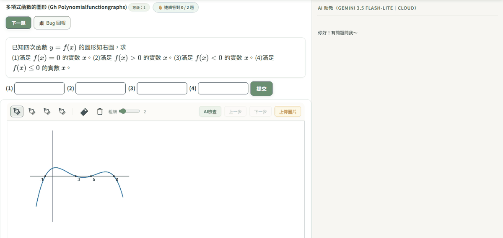
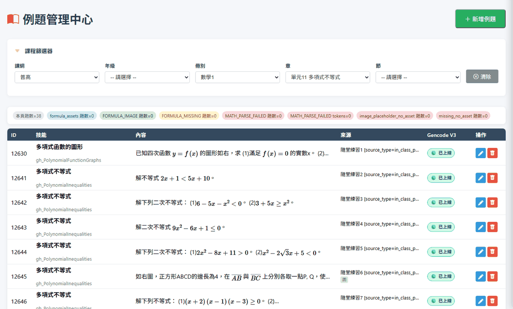
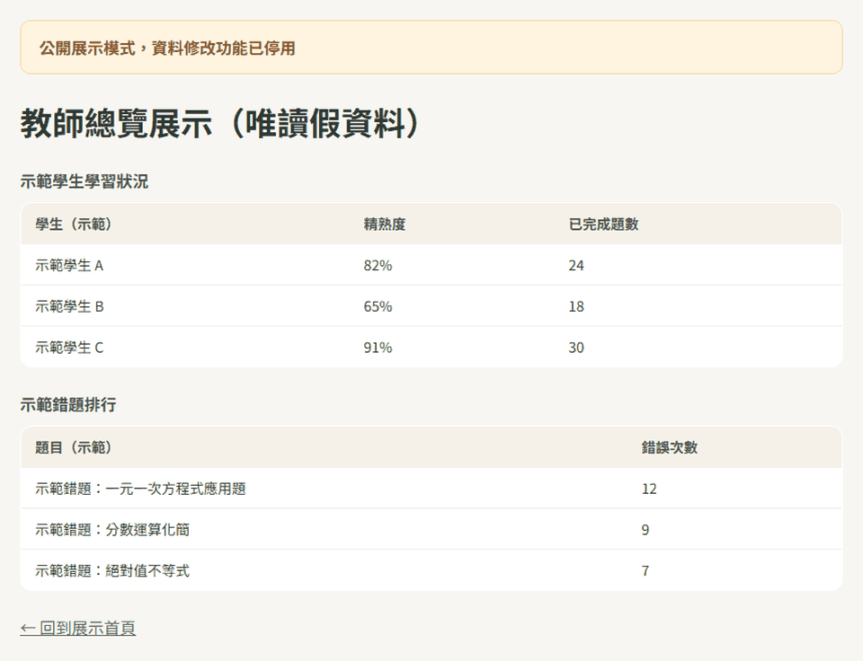
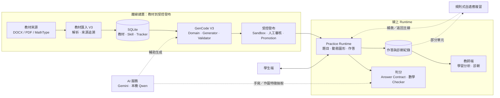
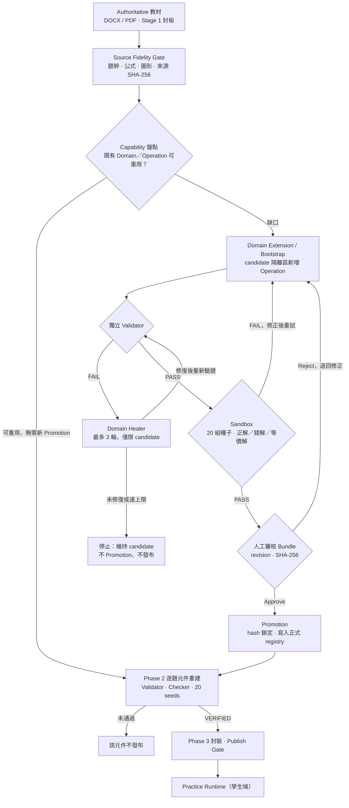
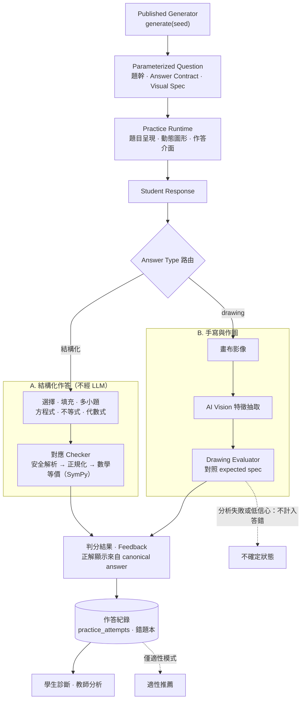

# AI 自適應學習平台（MathProject）— Verified AI Code Generation for Adaptive Mathematics Learning

**AI 自適應學習平台**是一套具備**可驗證 AI 程式生成**、**數學判分**與**適性學習**能力的數學教學平台（專案代號 MathProject）。

> **▶️ 公開 Demo（唯讀）：<https://mathb.math-adaptive.org/review-demo>** — 展示模式僅開放技高課綱、不寫入正式資料（`core/guest_demo.py`）。

**公開 Demo** 目前開放技術型高中數學 B 系列供實際體驗；README 中的部分畫面則展示已完成的普通型高中數學第一冊 GenCode V3 工程成果。

我的父親是一位有二十多年教學經驗的技術型高中數學老師。這個專案從他的真實教學需求開始：最早只是一個參加競賽的 AI 數學教學原型，目的是讓學生有更多數學練習的機會。

開發過程中我才發現，真正困難的不是讓 AI 出題，而是三件事：教材如何完整匯入、出題程式如何重用，以及如何確保數學答案是對的。為了解決這些問題，我持續改版與重構，把「一道題」改成「一支會出題的程式」（Code-as-Content），並為這些由 AI 協助產生的程式建立數學驗證、隔離測試與受控發布流程，也就是 **GenCode V3**。

**目前系統已進入正式教學環境：2 個班級、50 位學生在學校課堂使用，也在家自主練習。** 系統持續蒐集真實作答紀錄，供學習診斷與教師分析使用，師生的回饋持續影響改進。學習成效尚未經實驗驗證。

---

## Why I Built This

一開始我並不確定老師真正需要什麼，所以直接問父親：「如果真的拿到班上，你會不會用？」「哪裡不好用？」「真正需要的是什麼？」系統就是在開發、試用與進班的過程中，依實際遇到的問題一步步長出來的；我不是先決定要用某個 AI 模型，再去找應用場景。

---

## From Classroom Problems to Engineering Solutions

| 教學問題 | 工程設計 | 對應技術 |
| --- | --- | --- |
| 一整冊教材不能靠人工輸入 | **教材匯入系統**：同時讀取 Word 與 PDF，整理成冊、章、節、技能與例題，保留每題來源 | DOCX／PDF／MTEF、LaTeX、來源 SHA-256 與錨點（模組 1） |
| 固定題目無法支撐持續練習 | **Code-as-Content**：一題＝一支依參數與種子出題的 Generator，答案同步計算 | GenCode V3、Domain／Operation、參數化 Generator（模組 2） |
| AI 產生的題目如何確認沒有數學錯誤 | **精確運算＋獨立 Validator＋Sandbox＋人工審核＋hash 鎖定 Promotion** | SymPy／Fraction、Healer、Bundle／Revision（模組 3、10） |
| 數學作答需要公式、手寫、作圖與提示 | **專用數學練習介面**、動態圖形、手寫畫布、AI 特徵抽取與 Drawing Evaluator、AI 助教 | MathJax、Visual Spec、Gemini Vision、Drawing Checker（模組 4、5） |

---

## 從 AI 出題到可驗證的生成系統（Evolution of GenCode）

GenCode 的演進，不只是讓 AI 產生更多程式，而是逐步把數學出題拆解成**可重用、可組合、可驗證**的工程元件。

| 世代 | 當時想解決的問題 | 主要設計 | 程式與文件 |
| --- | --- | --- | --- |
| **V1** 探索 AI 程式生成 | AI 能否依題型產生可執行、可反覆出題的 Python 程式？ | LLM 依規格產生技能程式，加上 AST／Regex Healer 修復與沙盒驗證 | `core/code_generator.py`、`core/healers/` |
| **V2** 題型規格化與重用 | 題型變多後，題型規格、共用數學能力與生成邏輯需要分開，不能一直重複開發 | 以 ProblemTypeSpec 作為題型規格的權威，Answer Contract／EquivalenceType Gate，`skills/` 只留薄入口外殼 | `agent_skills_v2/`、[V2 整合設計](docs/系統SOP/Gencode_AgentSkillV2整合/Gencode與AgentSkillV2整合總體設計_v0.3.md) |
| **V3** 組合式架構與受控發布 | 如何在重用與可信任之間取得平衡 | Domain Operation 與 Answer Contract／Checker 經 registry 組合；DOCX＋PDF 雙來源教材匯入；獨立 Validator、Sandbox、人工審核與 Promotion | `core/gencode/`、`core/registry/`、`core/domain/promoted/`、`agent_skills_v3/` |

V3 階段有三個設計選擇，都來自我實際遇到的問題：

- **為什麼 Word 與 PDF 要分工？** 數學教材的文字、公式與圖形需要不同的解析方式，單一來源難以同時保留結構與視覺保真。Textbook Importer V3 以 Word 為文字、章節與公式的主要來源，PDF 負責保留原始圖形並在必要時裁切，再把題幹與圖形配對、保留來源（這是教材匯入的演進，與 GenCode V3 的職責不同）。
- **為什麼題型與答案規則要拆開？** 我希望不同題型能共用數學能力與 Checker，避免大量重複與硬編碼。實作上，每個 Domain Operation 在 registry 中宣告自己的 handler、payload adapter、可支援的 Answer Type 與 Checker，相容性由 Gate 檢查（`core/gencode/registered_operation_dispatch.py`、`core/gencode/services/v3_capability_compatibility_validator.py`）。這是在**已宣告相容的組合內**重用，不是任意可插拔；新增組合仍須通過 Gate。
- **為什麼需要獨立數學驗證？** AI 生成的程式可以執行，不代表數學一定正確。因此答案由 Domain 的精確運算決定，另由獨立的 Validator 走不同路徑驗證，再經 Sandbox、人工審核與 Promotion 才發布。

---

## System at a Glance

### 教材與動態出題規模

| 已發布 Generator 範圍 | 元件數量 |
| --- | ---: |
| 技術型高中數學 B 系列 | 487 |
| 普通型高中數學第一冊 | 398 |
| **正式發布合計** | **885** |

系統已匯入技高數學 B1～B4 與普高第一冊教材，並將通過驗證與發布流程的題型轉換為可執行的參數化 Generator。以上統計為正式發布的參數化 Generator 元件，不代表固定題庫數量，也不代表所有匯入教材都已有正式 Generator。

> **Published** ＝ 已編入正式 production manifest、具對應 wrapper（`skills/`），且通過驗證並記錄於 `gencode_component_tracker` 的元件（截至 2026-10-24，核對自 `instance/kumon_math.db` 與 `agent_skills_v3/*/component_manifest.json`）。

**使用現況**：2 個班級、50 位學生在學校課堂與家中自主練習使用，系統持續蒐集真實作答紀錄。2026-10-04 的資料快照為累積 1,224 次實際作答、平均答對率 67%；這是歷史快照，不是最新數字，也不是學習成效改善的證據。

其他規模（`core/` 約 25 萬行 Python、約 5,300 個測試函式、13 個已 Promotion 的 Domain、121 個 Operation）來自 `core/`、`tests/`、`configs/gencode_promoted_capabilities.json` 的靜態統計。

---

## System Demonstration

學生練習與題型管理畫面取自本機測試環境（資料庫副本；使用者帳號與姓名已匿名化）；教師分析為公開 Demo 的固定假資料頁。

**學生練習介面** — 數學公式渲染、由題目參數即時產生的函數圖形（含根的標示）、多小題輸入、手寫畫布與 AI 助教（普高 Unit 11）。


**GenCode V3 教材／題型管理介面** — 例題管理中心顯示各題的 Gencode V3 狀態（「已上線」）與公式診斷計數（普高 Unit 11，38 題）。


**教師分析介面（Demo 固定假資料）** — 公開展示模式 `/demo/teacher-overview` 的唯讀頁，以固定的示範學生與錯題資料呈現教師總覽；正式教師端另有班級與個別學生分析頁（`/teacher/analysis`）。


---

## System Architecture



主要目錄：`core/`（匯入、GenCode、checker、adaptive、routes）· `agent_skills_v3/` 與 `skills/`（已發布題型）· `templates/`、`static/` · `tests/` · `docs/`。完整說明見 [`docs/REPOSITORY_STRUCTURE.md`](docs/REPOSITORY_STRUCTURE.md)。

---

## Engineering Challenges & Technical Implementation

### 系統模組與核心工程課題（System Modules & Engineering Challenges）

| 系統模組 | 核心技術 | 關鍵工程課題 | 實作與驗證 |
| --- | --- | --- | --- |
| 1. 教材解析與匯入 | DOCX、PDF、MathType／MTEF、LaTeX、來源錨點、圖片關聯 | 從含公式與圖形的非結構化教材建立結構化題目，並保留來源追溯 | `core/textbook_importer_v3_*.py`、`core/mtef/`、`core/textbook_pdf_visual.py`；來源 SHA-256 與 `question_anchor`；`tests/` 中的 DOCX／MathType 測試；[Stage 1 SOP](docs/系統SOP/Gencode_AgentSkillV3整合/SOP_Gencode_V3_Lean.md) |
| 2. GenCode V3 | AI Code Generation、Domain Function、Operation、Generator、Healer、Validator | 讓 AI 產生可執行、可重用、符合數學與題型契約的出題程式 | `core/gencode/`、`core/gencode/domain_bootstrap/`、`agent_skills_v3/`；`tests/gencode/`（182 個檔案）；[PipelineFlow](docs/系統SOP/Gencode_AgentSkillV3整合/SOP_Gencode_AgentSkillV3_PipelineFlow.md) |
| 3. 數學 Oracle 與判分 | SymPy、Fraction、答案正規化、數學等價 Checker | 區分表示不同但數學等價的答案，並讓題目、標準答案與 Checker 一致 | `core/domain/promoted/`、`core/checkers/`；[數學答案檢核原則](docs/系統SOP/數學答案檢核原則_v1.12_20260908.md)；`tests/domain/` |
| 4. AI 手寫與作圖批改 | Gemini Vision（雲端）、筆跡特徵抽取、Drawing Checker、Evaluator | 處理手繪誤差與不確定結果：模型只抽取特徵，**由確定性 evaluator 判定**，而非像素比對 | `core/services/drawing_answer_analysis_service.py`（直線、拋物線、三次函數、不等式區域、直方圖）；`tests/test_drawing_vision_analyzer.py`、`tests/test_cubic_graph_drawing_evaluator.py` |
| 5. 動態數學視覺化 | JavaScript Canvas、Visual Spec、MathJax 3（SVG 輸出） | 讓隨機生成的函數、圖形、標籤與答案保持一致 | `static/js/visual_spec.js`；圖形由題目參數即時建立；`tests/test_practice_visual_spec_rendering.py`、`tests/test_practice_layout_shared_contract.py` |
| 6. 適性學習 | 規則式自適應複習（部分單元）；AKT／PPO／RAG 研究支線 | 依作答表現估計學習狀態，決定練習、補救或返回主線 | `core/adaptive/session_engine.py`；研究支線的 `core/adaptive/ppo_adapter.py`、`models/adaptive/phase2_policy.pt` 與 `tests/test_adaptive_phase*_policy.py`（範圍見[實作現況](#實作現況)） |
| 7. 知識圖譜 | Skill、Prerequisite、Knowledge Graph | 建立技能間依賴供診斷與補救使用 | `kg_outputs/`（24 個國中知識圖譜 JSON）、`/knowledge-graph` 頁、`skill_family_bridge`（67 筆）；先備關係管理與查詢已實作，目前資料庫尚未填入先備資料 |
| 8. 教師與學生學習分析 | 學習歷程、錯題本、班級分析、診斷 | 整合不同練習來源與歷史作答，提供可解釋的學習狀態 | `core/teacher_analysis_service.py`、`core/diagnosis_analyzer.py`、`core/mistake_notebook_service.py`；`/teacher/analysis`、`/student/diagnosis` |
| 9. Web 系統與資料管理 | Flask、SQLAlchemy／SQLite、Flask-Login、角色（學生／教師／管理員） | 整合教材、使用者、練習、批改與分析服務 | `app.py`、`models.py`、`core/routes/`；乾淨 Clone 啟動會自動建立 34 張表並通過 `/healthz` |
| 10. 驗證與發布管線 | Sandbox、Validator、Promotion、SHA-256、Bundle、Revision、Regression Tests | 讓 AI 產生的程式經驗證、人工核准與隔離測試後才進入學生端 | `core/gencode/reviewed_capability_promotion.py`、`core/gencode/v3_production_publish_service.py`；`reports/gh_unit*_deploy/`（backup→promote→rebuild→publish→verify-live→accept） |

---

## GenCode V3 & Code-as-Content

傳統題庫保存「題目＋答案」；這裡保存的是「會出題的程式」（**Code-as-Content**）：模型依教材例題與題型規格建立 Python Generator，驗證後發布；之後的變化題由程式依參數與種子反覆產生並同步計算答案，不需每題重新呼叫 AI。但模型產生的程式不能直接發布，因此需要下列流程。

GenCode V3 以「**Domain 決定數學、Generator 組題、Validator 獨立檢查、Checker 判學生答案**」分工：



流程依 [PipelineFlow](docs/系統SOP/Gencode_AgentSkillV3整合/SOP_Gencode_AgentSkillV3_PipelineFlow.md) 與實際部署腳本繪製：既有 Domain 可重用時只需重建元件，**新增 Domain／Operation 才需要 Promotion**；Domain Healer 最多 3 輪（`MAX_HEALER_ROUNDS`），不保證修復成功。三個核心設計：

**A. Separation of Concerns** — Generator（`agent_skills_v3/<skill>/components/src_<id>/generate.py`）只負責參數化與組題；精確數學運算在 Domain（`core/domain/promoted/<package>/`）；Validator 另行驗證；學生作答由 `core/checkers/` 依 Answer Contract 判分。AI 不決定正確答案。

**B. Independent Verification** — 每個 Operation 同時有 `build_*_matrix`（求解）與 `validate_*_matrix`（驗證）。兩者盡量走不同路徑，例如 Domain 以符號號誌表求不等式解集，Validator 以 SymPy `solve_univariate_inequality`、取樣點檢查或回代驗證。這降低同一錯誤被兩邊同時接受的風險，但仍是有限測試，不是形式化證明。

**C. Controlled Promotion** — 新 Domain／Operation 必須先在 candidate 與 Sandbox 通過，再產生 **Bundle**（`promotion_bundle.json`）：其中列出套件每個檔案的 **SHA-256**、涵蓋的 Operation 與測試案例，以及 `review` 區塊。只有人工將 `review.status` 設為 `human_approved` 後才能 Promotion；已 Promotion 的套件以 digest 鎖定，後續新增 Operation 必須建立新的 **Revision**（`revision_0002`…）與新 Bundle，重新審核，不可就地修改。範例：`reports/domain_operation_workspaces/capability_polynomial_inequality_*/`。

> **關於「Verified」**：指通過本專案定義的 Validator、Answer Contract、Sandbox 與發布檢查（見 [SOP](docs/系統SOP/Gencode_AgentSkillV3整合/SOP_Gencode_V3_Lean.md)），**不等同於**已對所有題目做形式化證明。

---

## Parameterized Question Generation

MathProject 不是儲存固定題庫，而是由教材建立**可參數化的出題程式**。

**執行路徑**（`agent_skills_v3/gh_*/components/src_<id>/generate.py`）：`seed` → 選取內嵌的 variant 參數組（`seed % len(variants)`，超出清單長度即循環）→ Domain Operation 以精確運算求解並建立題幹、答案契約與圖形規格（`visual_spec`）→ 回傳一題 payload。題幹、答案與圖形使用一致的參數來源，並透過 Domain 驗證、Checker 契約與圖形一致性測試降低內容不一致的風險（有限測試，非形式化證明）。呼叫路徑為 `core/gencode/registered_operation_dispatch.py`。

### 五個不同的指標

| 指標 | 意義 | 目前可證實的數字與說法 |
| --- | --- | --- |
| Published Generator Components | 已正式發布的出題元件 | 885（見上表） |
| Configured Parameter Variants | 元件內嵌、可被種子選取的參數設定 | 普高 398 個元件合計 **9,663 組**（中位數 20／元件）。這是**設定數**，不是已證實互異的題目數；技高 B1／B2／B4 由 Domain 依種子取樣，沒有可計數的清單，不做估計 |
| Questions per Invocation | 呼叫一次 `generate()` 產生的題目數 | 1 題（多小題為單一題目 payload 的多個 part） |
| Validated Seed Samples | 元件通過的生成驗證樣本 | 正式協定：每元件 20 組確定性種子（Lean SOP §5.1）；是驗證樣本數，不是題目上限 |
| Observed Distinct Questions | 實際觀察到互不重複的題目 | Unit 10／11 的沙盒測試要求 20 組種子至少產生 18 種不同題面；其餘單元未逐一統計，不外推 |

參數選取為 `seed % len(variants)`：種子超過參數組數量時會**循環回到既有參數組**。因此本系統的重點是**參數化與可重現的生成能力**，而非題目總量；增加變化需新增參數組或擴大 Domain 的取樣範圍。

### 案例一：Unit 10 三次函數（`gh_GraphsOfCubicFunctions`）

- **工程問題**：隨機參數的三次函數，圖形、對稱中心與答案必須一致；作圖題需要可靠的批改。
- **設計**：6 個 Operation（對稱中心式、由條件求函數、敘述判斷、圖形配對等，`agent_domains_candidate/function_cubic/`）；圖形曲線由同一組係數取樣；作圖題由視覺模型抽取特徵，再由 `evaluate_cubic_graph` 判定（`core/services/drawing_answer_analysis_service.py`）。
- **驗證**：沙盒測試逐點檢查圖形曲線與答案描述的函數誤差小於 0.002；Evaluator 對正確、鏡像、位移、拋物線、空白圖形分別判定；另有真實視覺模型檢查腳本（`reports/gh_unit10_grader/`）。已發布 26 個元件。

### 案例二：Unit 11 多項式不等式（`gh_PolynomialInequalities`、`gh_PolynomialFunctionGraphs`）

- **工程問題**：同一組數學能力要支援解集（含重根、無實根、根號端點）、由解反求參數、應用題與由函數圖形讀解集；答案的寫法多樣（`x≠2`、`1<x<3 或 x>5`、含 `√` 的端點）。
- **設計**：單一 Domain `inequality.polynomial` 提供 5 個 Operation，涵蓋 38 題；以因式分解與符號號誌表精確求解；共用 `inequality_solution_checker` 擴充支援單點與 `≠` 解集；應用題的示意圖與函數圖由參數即時產生。
- **驗證**：Domain 測試 81 項（含竄改答案與退化輸入）；每個元件的沙盒閘門與手算標準答案（例如 `(1±√5)/2`、`3≤x≤1+√7`）；Phase 2 隔離演練後，經人工核准才 Promotion（revision 1：35 題；revision 2：另外 3 題）。

---

## Practice & Assessment Pipeline — 學生作答與判分流程

不是每一題都交給 LLM 判分。結構化題型由數學 Checker 以確定性方式判分；AI Vision 只用於手寫與作圖題的**特徵抽取**，最後仍由 Evaluator 判定。



- **路由依據**：Answer Contract 的 Answer Type（`short_answer`、`single_choice`、`multi_part`、`table_fill`、`drawing`），評分路徑為 `answer_contract → runtime dispatch → core/checkers`（[Lean SOP §4](docs/系統SOP/Gencode_AgentSkillV3整合/SOP_Gencode_V3_Lean.md)）。
- **作圖不確定狀態**：視覺分析逾時、失敗或信心不足時回報系統錯誤，不計入答錯（`core/services/drawing_answer_analysis_service.py`）。
- **範圍說明**：適性推薦只在適性模式啟用；適性模式中少數 B4 第 1 章自由作答題另由 AI 判定（`core/vocational_math_b4/adaptive/`），屬有限範圍。

### 數學計算與 AI 教學的分層

- **第一層：數學計算**（Domain、Generator、Checker、SymPy）。題目、標準答案與判分由程式負責；答案與題目由同一組參數計算，不由 AI 另行生成，因此可用測試反覆驗證。
- **第二層：AI 教學輔助**（AI 助教）。解釋題意、分段提示、分析錯誤，以「觀察、聯想、執行」三步提問引導學生自己思考，並可讀取學生的手寫算式；回覆前由程式檢查是否洩漏答案（`core/ai_tutor_disclosure.py`，`tests/test_ai_tutor_disclosure.py`）。
- **手寫與作圖**：AI Vision 只抽取特徵，由 Drawing Evaluator 判定，兩者分工。
- **限制**：AI 助教的提示仍可能出錯，需要持續檢查，不應視為完全可靠；也不是所有手寫計算或圖形題都走同一條判分路徑。

---

## Engineering Lessons from Classroom Feedback

這三個問題都在試用過程中出現，修正後由回歸測試保護，避免同類問題再發生。

| 遇到的問題 | 根本原因 | 設計修正 | 對應測試 |
| --- | --- | --- | --- |
| **題目缺少必要參數**：要求計算 a＋b，卻沒有定義 b | 題幹所問的符號未在題幹或圖形中定義 | 題目品質閘門檢查「被詢問的變數必須在題幹中定義」，回報 `asked_variable_undefined`（`core/gencode/question_quality_gate.py`） | `tests/test_question_quality_gate.py` |
| **答案數學正確卻被判錯**：分數、小數、區間、LaTeX 的等價寫法 | 以字串或單一格式比對答案 | 答案解析 → 正規化 → 數學等價，並由共用 Checker 處理（`core/checkers/`） | `tests/test_b1_answer_equivalence_regression.py`、`tests/test_gencode_expression_equivalence_checker.py`、`tests/test_interval_checker.py` |
| **作圖題不能強迫用文字輸入**：答案在坐標平面、數線或手寫區 | 把作圖題當成填充題處理 | 獨立的 `drawing` Answer Type、作答模式與 Drawing Checker／Evaluator | `tests/test_free_response_drawing_checker.py`、`tests/test_drawing_pipeline_e2e.py` |

---

## Adaptive Learning & Research

- **正式系統功能：規則式自適應複習（部分單元）**。流程為主線題目 → 作答 → 更新能力值與錯誤紀錄 → 判斷穩定卡點 → 前置技能補救 → 返回主線（`core/adaptive/session_engine.py`）。各單元完整度不一致，跨單元擴充仍在進行。
- **學習紀錄與分析**：`practice_attempts`、`learning_diagnosis`、`mistake_notebook_entries` 等資料表支援錯題本、班級與個別學生分析頁。
- **團隊研究支線（RL 模型自適應研究）**：AKT 學習狀態推估、PPO 學習路徑決策與 RAG 補救檢索，主要由另一位團隊成員負責，**目前尚未整合進正式的自適應複習**。倉庫內的 `core/adaptive/akt_adapter.py` 是啟發式 AKT stub（程式內明文標示並非真實 AKT 模型）；PPO 策略（`core/adaptive/ppo_adapter.py`、`models/adaptive/phase2_policy.pt`）輸入 8 維狀態、輸出 `stay`／`remediate`／`return`，只涵蓋 5 個算術 Skill；RAG 補救已自 Phase 1 runtime 移除，僅保留實驗資料。
- **尚未完成**：學習成效驗證（前後測、分組設計、匿名化與資料使用規範）。`Simulated_student/` 為模擬實驗工具，不代表真實學習成效。

---

## Engineering Trade-offs：從 localhost 到真實課堂

少數人試用時，每次都呼叫大型雲端模型看不出問題；數十位學生長期使用後，API 費用、回應速度與資料外傳才變成實際問題。因此模型不綁定單一供應商：已實作 Gemini 串接、本機 Qwen 選項與全域調度策略（`local_first`／`cloud_first`／`hybrid_balanced`，可依角色配置模型，見 `core/ai_settings.py`）。

正式部署為單一台自管主機（Waitress ＋ Cloudflare Tunnel）。尚在驗證的項目包括：本機模型的品質與速度、混合調度與 fallback 策略，以及成本與品質的取捨；目前尚未證明小型模型可以取代雲端模型，也沒有做大型併發測試。

---

## 實作現況

| 狀態 | 項目 |
| --- | --- |
| **已實際運作（Production）** | 教材匯入 V3 與來源追溯；GenCode V3 已發布題型（見上表）；Practice Runtime（單選、填充、多小題、作圖）；共用 Checker；動態圖形；規則式自適應複習（部分單元）；學習紀錄、教師端管理與分析頁；2 個班級的實際課堂使用；Waitress 部署與公開 Demo。 |
| **已測試（範圍有限）** | AI 手寫／作圖批改（單元與 evaluator 測試）；AI 助教與答案洩漏檢查；AI Tutor 多輪對話契約（[`docs/AI_TUTOR_CONVERSATION_CONTRACT.md`](docs/AI_TUTOR_CONVERSATION_CONTRACT.md)）。 |
| **研究原型** | 團隊研究支線：AKT（heuristic stub）、PPO 路由（5 個算術 Skill）、RAG 補救；知識圖譜視覺化與先備關係；模擬學生實驗。 |

**限制**：Published 範圍以上表為準，其餘教材與普高第二冊以後的 GenCode 覆蓋持續擴充；尚未以實驗驗證學習成效；測試依變更範圍執行，不以單次全量測試作為唯一品質依據。

---

## Development & Contributions

以下依專案文件與倉庫成果說明。

- **開發者**負責：真實教學需求的整理、系統架構與設計決策、教材匯入流程、GenCode 與數學驗證規格、前後端整合、測試除錯與驗收、正式部署與維護。架構、題型契約與驗證流程記錄於 [`AGENTS.md`](AGENTS.md) 與 [`docs/系統SOP/`](docs/系統SOP/Gencode_AgentSkillV3整合/SOP_Gencode_V3_Lean.md)。
- **技高數學教師**主要提供教學需求、課堂情境、課本資料與實際課堂回饋。
- **團隊研究支線**：RL 模型自適應研究（AKT／PPO／RAG）主要由另一位團隊成員負責，與正式系統工程分開進行。
- **AI Agent 輔助開發**：開發過程使用 Cursor、Claude 等 AI 編碼工具輔助，Agent 的作業邊界與驗證要求見 [`AGENTS.md`](AGENTS.md)。AI 輔助產生的程式並非全部由人工逐行撰寫；GenCode V3 的 Sandbox／Promotion Gate 針對其規範的生成元件，一般程式變更依測試與審查處理。
- **驗證證據**：約 5,300 個測試函式；各單元的 Stage 1、Sandbox、演練與驗收證據保存在 `reports/gh_unit*_stage1/`、`reports/gh_unit*_deploy/`；GenCode 元件的 Promotion 需人工核准（Bundle 的 `review` 區塊）。

---

## Getting Started

需求：Python 3.11 以上（生產環境使用 3.14）。

```powershell
git clone https://github.com/yyfsunnyboy/Mathproject_tvet_mathB.git
cd Mathproject_tvet_mathB
python -m venv .venv
.\.venv\Scripts\Activate.ps1
pip install -r requirements.txt
python app.py            # http://127.0.0.1:5000，GET /healthz 為健康檢查
```

乾淨 Clone 會自動建立空的資料庫結構；**教材與題庫資料、正式資料庫不在倉庫內**（由 `.gitignore` 排除），因此需自行匯入教材，或直接使用公開 Demo。

選用 `.env`（不要提交）：

```env
SECRET_KEY=正式環境必填，至少 32 字元的隨機字串
GEMINI_API_KEY=選填，僅 AI 功能需要
MATHPROJECT_DATABASE_URI=選填
```

正式部署：`.\run_production.bat`（Windows，Waitress）。測試：`pytest -q`，建議依變更範圍執行（[SOP §5.0](docs/系統SOP/Gencode_AgentSkillV3整合/SOP_Gencode_V3_Lean.md)）。AI 功能預設使用 Gemini（雲端），亦可設定本機 Qwen 模型（`core/ai_settings.py`）。

---

## Documentation

| 想了解 | 閱讀 |
| --- | --- |
| 專案結構與檔案治理 | [`docs/REPOSITORY_STRUCTURE.md`](docs/REPOSITORY_STRUCTURE.md) |
| GenCode V3 日常 SOP（匯入→生成→發布→驗收） | [`SOP_Gencode_V3_Lean.md`](docs/系統SOP/Gencode_AgentSkillV3整合/SOP_Gencode_V3_Lean.md) |
| 題型契約、Checker、Gate 規格 | [`Specification`](docs/系統SOP/Gencode_AgentSkillV3整合/SOP_Gencode_AgentSkillV3_Specification.md)、[`PipelineFlow`](docs/系統SOP/Gencode_AgentSkillV3整合/SOP_Gencode_AgentSkillV3_PipelineFlow.md) |
| 數學等價與 required form | [`數學答案檢核原則`](docs/系統SOP/數學答案檢核原則_v1.12_20260908.md) |
| 技高 Practice Runtime 契約 | [`docs/VOCATIONAL_PRACTICE_RUNTIME_CONTRACT.md`](docs/VOCATIONAL_PRACTICE_RUNTIME_CONTRACT.md) |
| 自適應規格與 AKT stub 說明 | [`docs/自適應實作/`](docs/自適應實作/ADAPTIVE_PRODUCT_SPEC_v1.md) |
| 各單元發布證據與測試 | `reports/gh_unit*_deploy/`、`reports/gh_unit*_stage1/`、`tests/gencode/` |
| Agent 作業規範 | [`AGENTS.md`](AGENTS.md) |

本倉庫不包含教材原檔（DOCX／PDF）、正式資料庫與學生資料（由 `.gitignore` 排除）；教材內容之權利歸原權利人，展示與使用授權以權利人條件為準。請勿提交金鑰或 `.env`。
