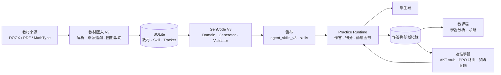
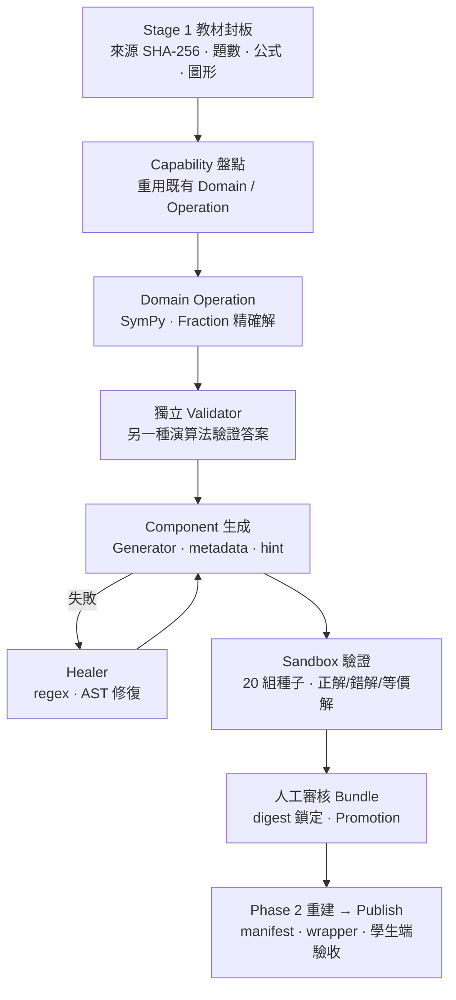

# MathProject — Verified AI Code Generation for Adaptive Mathematics Learning

> **▶️ 公開 Demo（唯讀）：<https://mathb.math-adaptive.org/review-demo>** — 可直接瀏覽教材、學生練習介面與教師端；展示模式不寫入正式資料。

MathProject 是一個以 Flask 實作的數學學習平台。它的核心工程問題是：**如何讓 AI 產生的出題程式，在進入學生端之前被證明數學正確、可判分、可追溯到教材來源。**

| 價值 | 內容 |
| --- | --- |
| 工程深度 | AI 產生可執行的出題程式（GenCode V3），經過 Domain 精確運算、獨立 Validator、Sandbox、人工審核 Promotion 後才發布。 |
| 研究價值 | 以 SymPy 作數學 Oracle，結合 AI 視覺特徵抽取＋確定性批改、知識追蹤（AKT）、PPO 路由與知識圖譜；各項成熟度見[實作現況](#實作現況已上線已測試研究原型)。 |
| 系統規模 | 技高數學 B1～B4 教材全數匯入（1,268 題）；普高數學第一冊 Unit 1～11（405 題）已逐單元封板並發布 398 題。 |

---

## 教材涵蓋範圍

| 範圍 | 教材匯入 | GenCode V3 題型程式 | 說明 |
| --- | --- | --- | --- |
| 技高數學 B1 | 321 題 | 314 題 verified | 3 章「式的運算」有 6 題待人工審核。 |
| 技高數學 B2 | 321 題 | 200 題 verified | 向量章有 6 題 failed，其餘持續遷移中。 |
| 技高數學 B3 | 373 題 | 373 個元件已建置（manifest 狀態 `package_ready`／candidate） | 尚未納入正式 tracker 驗證。 |
| 技高數學 B4 | 253 題 | 54 題 verified | 統計等章持續進行。 |
| **普高數學第一冊 Unit 1～11** | **405 題** | **398 題 verified** | 另 7 題為明確 DEFERRED／failed（Unit 1、2、5、9）。 |
| 普高第二～四冊、選修 | 早期匯入資料存在 | 未走 V3 封板 | 後續擴充，沿用第一冊 SOP。 |

> 數字來自 `instance/kumon_math.db` 的 `textbook_examples` 與 `gencode_component_tracker`（截至 2026-10-24）；「verified」指通過 V3 Gate 並寫入 tracker，不代表已完成所有人工教學審查。

---

## 系統架構



主要目錄：`core/`（匯入、GenCode、checker、adaptive、routes）· `agent_skills_v3/` 與 `skills/`（已發布題型程式）· `templates/`、`static/`（Web UI）· `tests/` · `docs/`。完整說明見 [`docs/REPOSITORY_STRUCTURE.md`](docs/REPOSITORY_STRUCTURE.md)。

---

## GenCode V3：可驗證的 AI 程式生成

AI 與規則只負責「組題與生成程式」；**數學答案由 Domain 的精確運算決定，並由另一條獨立路徑驗證**，不採信 AI 或 Generator 自己的輸出。



| 層 | 實作位置 | 作用 |
| --- | --- | --- |
| Domain / Operation | `core/domain/promoted/`、`core/registry/` | 每個 Operation 有 `build_*_matrix` 與獨立的 `validate_*_matrix`；Promotion 後檔案以 hash 鎖定，變更須新 revision 並重新審核。 |
| Validator | `core/gencode/services/v3_question_integrity_validator.py`、`answer_contract_gate.py` | 檢查題幹、答案契約、圖形與題型一致性。 |
| Checker | `core/checkers/`（20 餘種共用 checker）、`core/gencode/checker_registry.py` | 不等式、解集、方程式、表達式、選擇、多小題、作圖等判分；以數學等價而非字串比對。 |
| Healer | `core/healers/` | regex／AST 修復生成程式的語法與常見缺陷。 |
| Sandbox / Gate | `tests/gencode/test_gh_unit*_sandbox.py`、`reports/gh_unit*_deploy/` | 每元件 20 組確定性種子；演練腳本在臨時 store 與 DB 副本上跑完整 Promotion→重建→發布→學生端判分，並確認未寫入正式路徑。 |
| Promotion | `core/gencode/reviewed_capability_promotion.py` | 需人工 `human_approved` 才能寫入正式 store；每步驟備份與回滾點。 |

實例（普高 Unit 11 多項式不等式）：5 個 Operation 涵蓋 38 題，含參數反求、應用題與函數圖形；Domain 測試 81 項、Sandbox 閘門逐元件通過，隔離演練後才經核准發布。

---

## 其他技術重點

**SymPy 與數學 Oracle**（`core/domain/`、`core/checkers/`，54 個核心模組使用 SymPy）
答案以精確有理數／根號運算；判分採 `safe parse → normalize → 數學等價 → required form`（[數學答案檢核原則](docs/系統SOP/數學答案檢核原則_v1.12_20260908.md)）。測試以手算標準答案、錯答與等價寫法三面向驗證。

**DOCX／PDF／MathType 教材解析與來源追溯**（`core/textbook_importer_v3_*.py`、`core/mtef/`、`core/textbook_pdf_visual.py`）
DOCX 為文字與結構權威、PDF 為圖形權威；每題保存來源檔 SHA-256、題目錨點與 PDF 頁面／bbox；MathType（MTEF）公式轉 LaTeX；匯入前先 dry-run，並要求寫入範圍為零。流程見 [Stage 1 SOP](docs/系統SOP/Gencode_AgentSkillV3整合/SOP_Gencode_V3_Lean.md)。

**動態數學圖形與 AI 手寫批改**（`static/js/visual_spec.js`、`core/services/drawing_answer_analysis_service.py`）
圖形由題目參數即時產生（座標平面、多圖並列、函數曲線），不使用靜態教材圖。作圖題由視覺模型抽取筆跡特徵，**再由確定性 evaluator 判定**（直線、拋物線、三次函數、不等式區域、直方圖等），模型不直接決定對錯。

**適性學習**（`core/adaptive/`）
知識追蹤目前是**啟發式 AKT stub**（程式內明文標示，非真實 AKT 模型）；PPO 策略（`models/adaptive/phase2_policy.pt`）對 5 個算術 Skill 做 stay／remediate／return 路由；知識圖譜資料在 `kg_outputs/`。尚非全面上線能力，見下表。

**教師分析與學習資料管理**（`core/teacher_analysis_service.py`、`core/diagnosis_analyzer.py`、`core/mistake_notebook_service.py`）
作答紀錄、錯題本、診斷與班級管理；教師端提供學生學習分析與教材／技能管理頁面。

---

## 實作現況：已上線／已測試／研究原型

| 狀態 | 項目 |
| --- | --- |
| **已上線** | 教材匯入 V3 與來源追溯；GenCode V3 已發布題型（見涵蓋範圍表）；Practice Runtime（單選、填充、多小題、作圖）；共用 checker；動態圖形；教師端管理與分析頁；Waitress 正式部署與公開 Demo。 |
| **已測試（範圍有限）** | AI 手寫／作圖批改（有單元測試與 evaluator 測試）；PPO 路由（5 個算術 Skill）；AI Tutor 多輪對話契約（[`docs/AI_TUTOR_CONVERSATION_CONTRACT.md`](docs/AI_TUTOR_CONVERSATION_CONTRACT.md)）。 |
| **研究原型** | AKT（heuristic stub）；RAG 補救（已自 Phase 1 runtime 移除，保留實驗資料）；知識圖譜視覺化；模擬學生（`Simulated_student/`）。 |

限制與誠實說明：技高 B2～B4 與普高第二冊以後的 GenCode 覆蓋尚未完成；自適應模型未以大規模學生資料驗證學習成效；完整測試套件仍有少數既有失敗項，與目前單元無關，封板時另行處理。

---

## 快速開始

```powershell
git clone https://github.com/yyfsunnyboy/Mathproject_tvet_mathB.git
cd Mathproject_tvet_mathB
python -m venv .venv
.\.venv\Scripts\Activate.ps1
pip install -r requirements.txt
```

建立 `.env`（不要提交）：

```env
SECRET_KEY=至少 32 字元的隨機字串
GEMINI_API_KEY=選填，僅 AI 功能需要
MATHPROJECT_DATABASE_URI=選填
```

```powershell
python app.py            # 開發：http://127.0.0.1:5000
.\run_production.bat     # Windows 正式（Waitress）
```

健康檢查：`GET /healthz`。測試：`pytest -q`（建議依變更範圍執行，見 [SOP §5.0](docs/系統SOP/Gencode_AgentSkillV3整合/SOP_Gencode_V3_Lean.md)）。

---

## 文件導覽

| 想了解 | 閱讀 |
| --- | --- |
| 專案結構與檔案治理 | [`docs/REPOSITORY_STRUCTURE.md`](docs/REPOSITORY_STRUCTURE.md) |
| GenCode V3 日常 SOP（匯入→生成→發布→驗收） | [`SOP_Gencode_V3_Lean.md`](docs/系統SOP/Gencode_AgentSkillV3整合/SOP_Gencode_V3_Lean.md) |
| 題型契約、Checker、Gate 規格 | [`Specification`](docs/系統SOP/Gencode_AgentSkillV3整合/SOP_Gencode_AgentSkillV3_Specification.md)、[`PipelineFlow`](docs/系統SOP/Gencode_AgentSkillV3整合/SOP_Gencode_AgentSkillV3_PipelineFlow.md) |
| 技高 Practice Runtime 契約 | [`docs/VOCATIONAL_PRACTICE_RUNTIME_CONTRACT.md`](docs/VOCATIONAL_PRACTICE_RUNTIME_CONTRACT.md) |
| 自適應規格與 AKT stub 說明 | [`docs/自適應實作/`](docs/自適應實作/ADAPTIVE_PRODUCT_SPEC_v1.md) |
| 各單元發布證據 | `reports/gh_unit*_deploy/`、`reports/gh_unit*_stage1/` |
| Agent 作業規範 | [`AGENTS.md`](AGENTS.md) |

---

## 授權與資料

教材原檔（DOCX／PDF）、正式資料庫與學生資料不納入版本控制（由 `.gitignore` 排除）；請勿將金鑰或 `.env` 提交。
