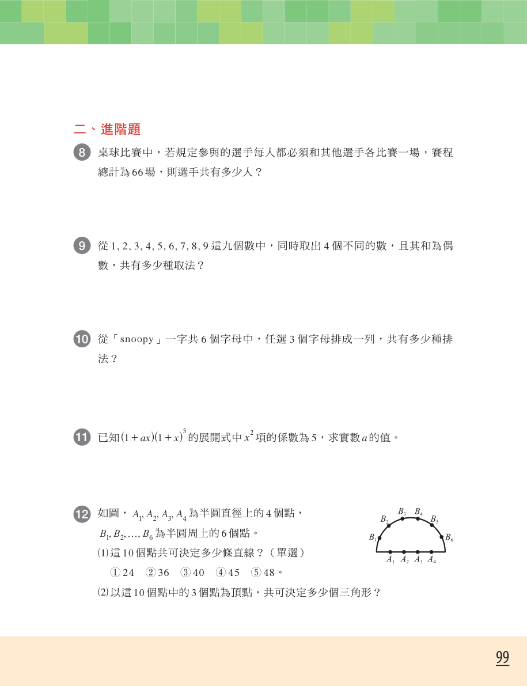
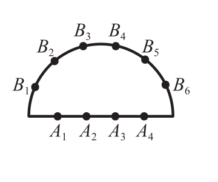

# 5習題 進階題12 圖像確認

狀態：**pending_teacher_confirmation**；目前未標記 verified，亦未寫入正式圖像設定。

- Anchor：`general_2_section_advanced_exercise_012_037`；DOCX block_index：36；PDF：第 16 頁（印刷頁 99）。
- PDF SHA-256：`e24c72f893099354886c288daef25eab59cd315facc778f7ffa96d4e242ec166`。
- 建議裁切：PDF points `xyxy=[420, 575, 540, 675]`；頁面大小 `[609.4486083984375, 793.7006225585938]`。

## 題幹

如圖，\(A_{ 1 } ,A_{ 2 } ,A_{ 3 } ,A_{ 4 }\) 為半圓直徑上的 \(4\) 個點，\(B_{ 1 } ,B_{ 2 } ,\ldots ,B_{ 6 }\) 為半圓周上的 \(6\) 個點。
(1)這 \(10\) 個點共可決定多少條直線？（單選）
①\(24\)　②\(36\)　③\(40\)　④\(45\)　⑤\(48\)。
(2)以這 \(10\) 個點中的 \(3\) 個點為頂點，共可決定多少個三角形？

## 原始頁面

## 建議裁切預覽

圖中半圓、直徑、A1–A4、B1–B6 均完整；裁切範圍不含進階題 11 圖形。請教師確認此圖確屬進階題12及裁切邊界，確認前 Gate 保持 BLOCKED。
